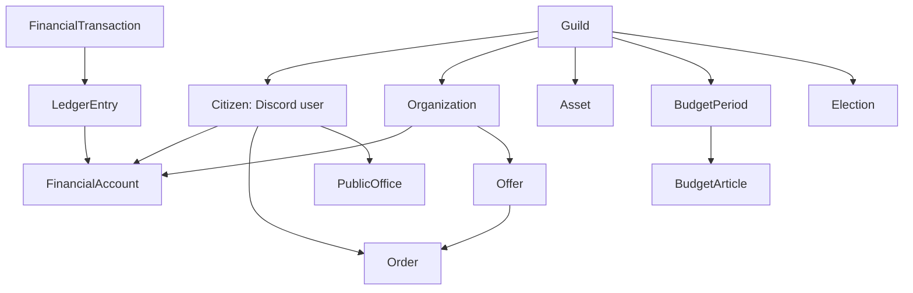

# Civitas — единая проектная спецификация

Версия 0.1.0 · 2026-11-11. Полный текст пакета документации для чтения одним файлом. Для работы в репозитории предпочтительнее архив с отдельными Markdown-файлами и `AGENTS.md`.

---


---

# Файл: `README.md`

# Civitas — проектная документация Discord-государства

**Версия документации:** 0.1.0 (проектное ТЗ, до начала разработки)  
**Дата:** 2026-11-11  
**Язык проекта:** русский  
**Статус:** концепция и спецификация; код бота пока не написан.

## Быстрый старт для Codex

1. Распаковать папку в корень нового Git-репозитория.
2. Прочитать этот `README.md` и `AGENTS.md`, затем документы `docs/` в указанном ниже порядке.
3. До реализации прочитать `docs/09_DECISIONS_AND_QUESTIONS.md`: там отделены принятые требования от предлагаемых параметров.
4. Начать с планирования **этапа 1**, а не со всего проекта сразу. Шаблон первого запроса — `prompts/START_CODEX.md`.
5. Не создавать систему персонажей: аккаунт пользователя Discord сам является гражданином.

## Суть проекта

**Civitas** — многопользовательская политико-экономическая игра в рамках **одного Discord-сервера** (до ~30 участников). Участники — граждане виртуальной республики. Они работают в государственных, частных и NPC-организациях, открывают компании, торгуют, владеют недвижимостью и активами, избирают власть, принимают законы и влияют на бюджет. Глубина экономики сочетается с доступным социальным RP.

**Основной интерфейс — Discord:** slash-команды, кнопки, select-menu, модальные формы, каналы, форумные темы, роли. Отдельный сайт, приложение и RPG-персонажи не входят в первую версию.

## Статус решений

- **Подтверждено пользователем:** до 30 человек; баланс симуляции и развлечения; глубокая экономика; Discord-only на старте; пользователь Discord = гражданин, **без** отдельного персонажа, здоровья, возраста, навыков или старения; будущая разработка и тестирование в Codex.
- **Направления, согласованные для проектирования:** президент, парламент, партии/выборы, работа, NPC-работодатели, бизнес игроков, налоги, бюджет, имущество и недвижимость.
- **Рабочие предложения, требующие утверждения:** устройство власти, сроки выборов, цены, налоговые ставки, стартовые балансы, лимиты, конкретные обязанности должностных лиц и состав MVP. Все такие значения вынесены в конфигурацию и реестр решений.

## Состав документации

| Файл | Назначение |
|---|---|
| `AGENTS.md` | Постоянные инструкции Codex по этому репозиторию |
| `docs/00_VISION_SCOPE.md` | Видение, аудитория, границы и критерии успеха |
| `docs/01_GOVERNMENT_RULES.md` | Конституционная модель, выборы, законы и доступ |
| `docs/02_ECONOMY_RULES.md` | Денежные потоки, работа, бизнес, собственность и баланс |
| `docs/03_FUNCTIONAL_REQUIREMENTS.md` | Проверяемые требования и матрица функциональности |
| `docs/04_TECH_ARCHITECTURE.md` | Технический стек, модули, интеграции и безопасность |
| `docs/05_DATA_MODEL.md` | Основные сущности и ограничения БД |
| `docs/06_DISCORD_UX.md` | Каналы, роли, slash-команды и сценарии взаимодействия |
| `docs/07_TEST_AND_ACCEPTANCE.md` | Критерии приёмки, тестовые сценарии и инварианты |
| `docs/08_DELIVERY_PLAN.md` | Поэтапная реализация и Definition of Done |
| `docs/09_DECISIONS_AND_QUESTIONS.md` | Принятые решения, гипотезы и открытые вопросы |
| `docs/10_OPERATIONS.md` | Сопровождение, модерация, резервные копии и защита данных |
| `docs/11_FUTURE_BACKLOG.md` | Будущие идеи вне первой версии |
| `config/game_rules.example.yaml` | Предлагаемые настройки для первого сезона, не production-конфигурация |
| `prompts/START_CODEX.md` | Готовый первый запрос для работы с Codex |

## Базовые принципы

1. **Люди создают игру:** автоматизация сокращает рутину, а не заменяет взаимодействие граждан.
2. **Экономика замкнута и учёт проверяем:** никакого безлимитного `/work`, все движения денег записываются и сверяются.
3. **Маленькое население:** работа доступна через NPC, если реальные работодатели неактивны; минимум обязательных государственных должностей.
4. **Один Discord-аккаунт — один гражданин в данном сервере**, при дополнительной защите выборов от мультиаккаунтов. Полной гарантии личности Discord не даёт.
5. **Политические роли — игровые:** они не получают права владельца/администратора Discord.
6. **Без реальных денег:** внутриигровая валюта не обменивается на реальные деньги, не является финансовым активом.
7. **Сначала вертикальный сценарий:** зарегистрироваться → заработать → открыть компанию → продать услугу → уплатить налог → потратить бюджет.
8. **Не добавлять систему персонажей и расширения вне MVP без явного запроса.**

## Терминология

- **Игрок / гражданин:** Discord-пользователь с зарегистрированным гражданством в этом сервере.
- **Республика:** игровая политическая система, не отдельная юридическая юрисдикция.
- **Казна:** игровой государственный денежный счёт.
- **NPC:** контролируемая ботом организация, а не отдельный человек-персонаж.
- **Civitas:** собственный бот и его серверное приложение.
- **MVP:** минимальный завершённый набор для запуска игрового цикла.
- **Предлагаемый параметр:** настраиваемое число или правило, которое ещё не утверждено пользователем.

## Внешние ориентиры для реализации (проверять перед написанием кода)

- Discord Application Commands: https://docs.discord.com/developers/docs/interactions/slash-commands
- Discord privileged intents: https://support-dev.discord.com/hc/en-us/articles/6207308062871-What-are-Privileged-Intents
- discord.py interaction API: https://discordpy.readthedocs.io/en/stable/interactions/api.html
- Codex `AGENTS.md`: https://learn.chatgpt.com/docs/agent-configuration/agents-md

Документы являются **проектом правил**, а не гарантиями возможностей сторонних ботов или рабочим приложением.


---

# Файл: `AGENTS.md`

# Инструкции Codex — Civitas

## Контекст

Civitas — бот для политико-экономической игры на одном Discord-сервере, ориентирован на <=30 участников. Прочти `README.md`, `docs/09_DECISIONS_AND_QUESTIONS.md` и документы соответствующего модуля перед изменениями. **Нет отдельных персонажей**: игрок — зарегистрированный Discord-пользователь.

## Правила работы

1. Действуй поэтапно, по `docs/08_DELIVERY_PLAN.md`; не строй всю игру за один запрос. До кода предъяви план изменяемого среза и зависимости.
2. Обозначенные как `PROPOSED` параметры — не окончательные правила. Вынеси их в конфигурацию. Не выдавай свои догадки за принятые пользователем решения.
3. Python, `discord.py`, PostgreSQL, SQLAlchemy, Alembic, pytest, Docker Compose — предпочтительный стек, но перед установкой проверь поддерживаемые версии и совместимость.
4. Сохраняй слои: Discord handlers → application services → repositories/ORM; бизнес-правила и платежи должны тестироваться без Discord.
5. Деньги — целочисленные игровые единицы; транзакции — двойная запись, баланс равен сумме записей. Все движения атомарны, идемпотентны, с проверкой прав и аудитом. Никаких `float` для денег.
6. Отдельная системная роль эмитента допустима только для явно учтённого выпуска; счета граждан/фирм/казны не уходят в минус. Не создавать деньги из ниоткуда с помощью NPC-работ и еженедельных начислений.
7. Учитывай гонки: уникальные ключи, блокировки и транзакции БД для покупки одного объекта, начисления зарплаты, оплаты счёта и налогов.
8. Политические должности никогда не дают права Discord Administrator. Следуй принципу минимальных прав и проверяй авторизацию в сервисном слое, а не только в командах.
9. Выборы через сторонних ботов на старте могут требовать подтверждения результатов вручную; **не выдумывай API или гарантии анонимности**.
10. Не собирай лишних персональных данных; не публикуй приватные финансовые детали; не храни bot token в Git. Логи и резервные копии защищай.
11. Добавляй модульные и интеграционные тесты для бизнес-правил; прогоняй доступные проверки и указывай реальные результаты. Не объявляй тесты пройденными без запуска.
12. Новые зависимости/изменения правил сопроводи изменением документации. Не внедряй активы, кредиты, здоровье, старение, семьи или отдельные веб-приложения сверх текущего объёма без задачи.

## Общая последовательность задач

1. Сначала согласовать предлагаемые параметры первого сезона и MVP, помеченные в `docs/09_DECISIONS_AND_QUESTIONS.md`.
2. Затем scaffold + БД + регистрация граждан (итерация 1).
3. Затем ledger и переводы с тестами (итерация 2).
4. Затем работа, компании, сделки и налоги (итерации 3–4).
5. Затем казна/контракты/имущество, политика и Discord UX (итерации 5+).

## Завершение изменения

Сообщай: что изменено; какие миграции созданы; какие тесты запускались и их результаты; какие вопросы остались. Перед merge проверь инварианты из `docs/07_TEST_AND_ACCEPTANCE.md`.


---

# Файл: `docs/00_VISION_SCOPE.md`

# 00. Видение и границы проекта

## Проблема

Обычные Discord RP-государства сводятся к ролям и голосованиям; экономика не влияет на политику, а неактивность небольшого сообщества останавливает игру. Civitas должна формировать реальную причинно-следственную цепочку «действие гражданина → экономический результат → государственные решения → новые возможности».

## Цели

- До 30 игроков могут участвовать без ежедневного обязательного присутствия.
- Регистрация, работа, торговля, собственность и финансовые операции доступны внутри Discord.
- Правительство собирает налоги и тратит ограниченные деньги; депутаты меняют понятные правила через законы.
- У новых игроков есть безопасная стартовая занятость через NPC-организации.
- Любой значимый денежный поток имеет журнал и объяснимый источник/получателя.
- Игровой процесс не поощряет бесконечный спам командами.

## Основная аудитория

Небольшое сообщество друзей / приглашённых участников, интересующихся экономикой, социальными взаимодействиями и политическим RP без жёстких требований к присутствию. Игрок может быть предпринимателем, наёмным работником, активистом, журналистом, политиком или просто гражданином.

## Подтверждённые ограничения

- Сначала **только Discord**; отдельного веб-интерфейса нет.
- **Аккаунт Discord и гражданин — одно игровое лицо**. Отдельных RPG-персонажей, возраста, здоровья, обучения, навыков, старения и наследников нет.
- Небольшой сервер: до 30 участников.
- Баланс RP и симуляции; экономика глубокая, но не бюрократичная.
- Разработка и тестирование позже, поэтапно в Codex; этот пакет — спецификация, не код.

## Объём первого игрового релиза (MVP/R1)

**Обязательно:** гражданство и роли, счёт гражданина и казны, перевод денег, журнал, простая NPC-работа, регистрация компаний, счета компаний, оплачиваемый заказ/сделка, налог на коммерческую продажу, бюджет и отчет, базовая собственность с покупкой, выборы через проверенный внешний процесс и запись результатов, базовые правила управления.

**Допускается вручную с бот-поддержкой:** рассмотрение законов, избирательная комиссия, разрешение сложных споров, создание объектов недвижимости, проверка трудовых заданий, госзаказы.

**Релиз R1.1+:** постоянные трудовые договоры и сложный payroll, аренда, вторичный рынок активов, автоматическая реализация правовых норм, регистрация партий через бота, тендеры/конкурсы, расширенный арбитраж.

**Вне текущего объёма:** RPG-персонажи, характеристики, навыки/обучение как развитие персонажа, здоровье, старение, семья, наследство; кредиты, фондовый рынок, сложная промышленная цепочка; международная торговля с другими серверами; реальные платежи.

## Сценарий для доказательства жизнеспособности

1. А зарегистрировался и получил стартовую валюту один раз.
2. А выполнил ограниченное NPC-задание и получил оплату из выделенного бюджета.
3. Б зарегистрировал компанию и выставил услугу.
4. А оплатил услугу: средства безопасно зарезервировались; после подтверждения Б получил доход за вычетом налога, казна получила налог.
5. Депутаты согласовали бюджет; президент разместил оплачиваемый государственный заказ.
6. Компания Б выполнила заказ и получила деньги из казны.
7. В отчёте видны оборот, остатки, налоги и расходы. В журнале можно восстановить каждую операцию.

## Проверяемые показатели после первого сезона (целевые гипотезы)

- >= 50% зарегистрированных граждан совершили осмысленное действие (работа, сделка, голосование, заявка) за 28 дней.
- >= 5 завершённых сделок между людьми/компаниями (без принудительного фарма).
- >= 2 действующих компании, кроме NPC.
- Нет подтверждённых расхождений финансового журнала, двойных выплат и отрицательных обычных балансов.
- Не менее одного опубликованного отчёта казначейства и одного политического решения, влияющего на игру.

Показатели — ориентиры оценки, не обещания и не обязательные условия для запуска.

## Принципы UX

- Новому гражданину достаточно пройти регистрацию и нажать «Найти работу».
- Обычное действие: 1–3 взаимодействия, сложное — через пошаговую форму.
- Никаких необязательных формальных должностей и пустых каналов.
- Действия, требующие решения человека, имеют срок и понятный статус.
- Чётко разделены внутриигровые санкции и модерация Discord.


---

# Файл: `docs/01_GOVERNMENT_RULES.md`

# 01. Государство и политика

> Все численные параметры ниже являются **PROPOSED** до утверждения пользователем. Предлагается парламентско-президентская республика.

## Институты

| Сущность | Предлагаемое устройство | Полномочия |
|---|---|---|
| Гражданин | Регистрация в Civitas | Торговля, работа, участие в общественной жизни; избирательные права при соответствии правилам |
| Президент | Один избранный на 28 реальных дней | Выполняет утверждённый бюджет, представляет государство, вносит проекты |
| Парламент | Три избранных депутата | Принимает законы, утверждает бюджет, проверяет расходы |
| Избирательная комиссия | Технически доверенные независимые модераторы/граждане | Проверка списков и подтверждение итогов |
| Арбитраж | Судья/арбитр для отдельного случая | Разрешает игровые договорные споры; не модерирует Discord |
| Техническая администрация | Владелец и доверенные модераторы | Стабильность сервера, безопасность и соблюдение Discord-правил |

При < 10 допущенных граждан: **временное прямое голосование сообщества**, без обязательного заполнения четырёх постоянных выборных должностей. При 10–30 — 3 депутата и 1 президент. Порог — предлагаемый, настраиваемый.

## Выборы

- Политический цикл: **28 дней** (предложение).
- Голосование: **48 часов**, асинхронно.
- Избиратели: граждане, зарегистрированные до фиксированного момента закрытия списка; критерии допуска/анти-мультиаккаунт — на утверждение.
- Предлагаемый кворум: не менее **40%** допущенных, но не менее **4** при численности >=10; число голосов округляется вверх. При недостижении — одно продление на 24 часа, затем новые выборы.
- Президент — относительное большинство (при равенстве — повторное голосование между лидерами); депутаты — голосование за кандидатов с тройкой лучших; метод должен быть утверждён до запуска.
- Нельзя заявлять полную криптографическую тайну голосов при использовании внешнего Discord-бота. Избирательная комиссия фиксирует способ подсчёта и конфликт интересов.
- На старте используется **EasyPoll (или эквивалент после проверки возможностей)**; Civitas регистрирует выборы и **подтверждённый вручную** протокол. Не предполагать автоматический API импорта голосов.
- Фиксацию итогов должен подтверждать второй независимый доверенный оператор, если персонал позволяет; аварийное исключение владельца — с публичным объяснением и аудитом.
- Права Discord Administrator/Manage Server не выдаются выборным политикам.

## Работа парламента

1. Гражданин или должностное лицо публикует идею законопроекта через `/law propose` или форумную тему.
2. Обсуждение минимум **24 часа** (предложение), затем текст фиксируется.
3. Депутаты голосуют за/против/воздержались в течение **48 часов**.
4. Обычный закон принят при минимум двух «за» из трёх (если имеются вакансии — применяется отдельный утверждённый регламент, а не автоматическое снижение порога).
5. Для изменения параметров экономики закон содержит валидированное описание изменений, например `company_sales_tax_rate: 0.10 → 0.15`.
6. Изменения вступают в силу с начала следующей бюджетной недели, не задним числом. Согласованные ранее сделки используют зафиксированную ставку по условиям сделки.
7. Конституционные изменения — специальная процедура (предложение: единогласие парламента + референдум).

**Запрещено:** выполнять произвольный код/SQL из текста закона, менять права Discord или тайно править балансы граждан. Законы изменяют только разрешённые параметры и процедуры.

## Правительство и бюджет

- Казна принадлежит игровому государству, не лично президенту.
- Парламент утверждает недельный бюджет по категориям; расходы и блокировки средств проверяет бот.
- Президент вправе инициировать платежи **только в пределах доступной бюджетной статьи и остатка казны**.
- Дополнительный выпуск валюты — отдельное действие со строгими правилами, не скрытая прерогатива администрации.
- Предлагаемый недельный верхний предел расходов: **800 ₵** на все бюджетные категории вместе. Нельзя отдельно расходовать 800 на NPC и ещё 800 на зарплаты.
- Отчёт публикуется еженедельно: баланс казны, налоги, расходы по статьям, открытые обязательства, эмиссия, число сделок.

## Партийная система

- Партии добровольны. Предлагаемый порог регистрации: 3 действующих гражданина.
- Возможно независимое участие в выборах.
- На R1 партии могут существовать как Discord-роли/форумы; деньги партий и членские взносы — позднее.

## Юрисдикция и санкции

- Арбитраж рассматривает игровые сделки, не действия в реальном мире.
- Администраторы Discord могут вмешаться в мошенничество/травлю/платформенные нарушения независимо от игровой политики.
- Санкции описаны публично, пропорциональны и подлежат апелляции.
- Технические вмешательства в казну и имущество обязательно аудируются.

## Конфликт интересов

- Нельзя утверждать собственную выплату как единственный проверяющий.
- Аудитор не проверяет собственную компанию; арбитр не рассматривает свой спор.
- Решения с конфликтом интересов требуют другого уполномоченного лица.


---

# Файл: `docs/02_ECONOMY_RULES.md`

# 02. Экономическая система, работа, собственность

> Значения в этом документе — стартовые гипотезы **PROPOSED**, не окончательный баланс. Вся денежная система — **только игровая**.

## 2.1. Участники и денежные счета

- Гражданин: личный счёт (после регистрации).
- Компания игрока: отдельный корпоративный счёт, не смешивается с личным.
- Государственная казна: единый контролируемый счёт.
- Эскроу-счета: временная блокировка оплаты сделки/контракта.
- Системный эмитент (`SYSTEM_ISSUER`): специальный счёт для **явно разрешённой** эмиссии, включая начальное распределение. Не рассматривается как обычный собственник денег.

**Правила:** одна внутриигровая валюта ₵, целочисленные номиналы; нет отрицательных обычных счетов; переводы атомарные; нет скрытых коррекций балансов. Игра не использует платежи реальными деньгами.

### Предлагаемые численные параметры

| Параметр | Значение | Комментарий |
|---|---:|---|
| Стартовые деньги гражданина | 250 ₵ | Один раз при подтверждённой регистрации |
| Начальный баланс казны | 8 000 ₵ | Начальная эмиссия при создании государства |
| Регистрация компании | 150 ₵ | Перевод в казну |
| Налог с продажи компании | 10% | Считается от цены покупки, удерживается из выручки продавца |
| Недельный лимит расходов казны | 800 ₵ | Все статьи в сумме |
| Бюджет NPC-работ на неделю | 300 ₵ | Часть общего бюджета 800 ₵ |
| Личный лимит NPC-заработка в неделю | 100 ₵ | Против бесконечного фарма |
| Пример выплаты NPC-задания | 10–40 ₵ | Только после верифицированного выполнения |
| Пример госзарплат/нед. | Всего 120 ₵ | Внутри 800 ₵, за работу, не за роль |
| Пример госзаказов/нед. | 250 ₵ | Внутри 800 ₵ |
| События/гранты/нед. | 130 ₵ | Внутри 800 ₵ |
| Налог на перепродажу собственности | 2% | Предлагается отдельно от корпоративного налога |
| Дискреционная эмиссия | **Выключена** | Потенциальный лимит 400 ₵/нед. — лишь будущая настройка |

Балансовое разложение недельного бюджета в примере: 300 + 120 + 250 + 130 = **800 ₵**. Не все статьи обязаны быть потрачены. Если казна беднеет — расходы сокращаются, а не создаются деньги автоматически.

## 2.2. Потоки денег

| Событие | Источник | Получатель | Создание денег? |
|---|---|---|---|
| Подтверждение нового гражданина | SYSTEM_ISSUER | Гражданин +250 ₵ | Да, одноразово на гражданина |
| Создание государства | SYSTEM_ISSUER | Казна +8000 ₵ | Да, однократно |
| Работа на NPC | Казна, статья `npc_work` | Гражданин | Нет |
| Госзаказ | Казна, статья `contracts` | Компания | Нет |
| Продажа компанией на 200 ₵ | Покупатель −200 | Компания +180, казна +20 | Нет |
| Открытие компании | Гражданин −150 | Казна +150 | Нет |
| Зарплата в частной фирме | Компания | Сотрудник | Нет |
| Покупка недвижимости у государства | Гражданин | Казна | Нет |
| Продажа недвижимости между людьми | Покупатель | Продавец, казна (пошлина) | Нет |
| Одобренная эмиссия (позднее) | SYSTEM_ISSUER | Указанный счёт | Да, только при разрешении |

Начальная регистрация новых граждан — контролируемая одноразовая эмиссия. Она **не входит** в пока выключенный лимит дискреционной эмиссии. Нельзя повторно получать стартовые средства через повторную команду. Анти-мультиаккаунт — отдельная политика допуска.

**Инвариант двойной записи:** для каждой операции сумма всех signed `ledger_entries` = 0, включая системный счёт эмитента. Сумма счетов граждан/фирм/казны/эскроу = отрицательному балансу эмитента (если иных системных счетов нет). Системный эмитент — единственное исключение из запрета отрицательного баланса.

## 2.3. Компания игрока

- При регистрации: название, тип деятельности, владелец, уплата 150 ₵ с личного счёта, открытие отдельного корпоративного счёта.
- Один основатель — до **одной активной компании** на R1 (предложение; соучредителей пока нет).
- Компании создают услуги/заказы, нанимают сотрудников, участвуют в госзакупках, владеют оборудованием и недвижимостью.
- Баланс компании не равен личному балансу собственника. Вывод средств владельцу оформляется как отдельная операция с назначением.
- Вопрос об индивидуальном предпринимательстве и налогах на вывод средств отложен; **не вводить второй налог без закона**.
- Компания не получает автоматического дохода за существование.

### Обязательный коммерческий поток

1. Компания публикует предложение услуги (цена, описание, условия, срок).
2. Покупатель подтверждает заказ и платит 200 ₵ из личного/корпоративного счёта в эскроу.
3. Компания выполняет услугу, покупатель подтверждает выполнение. При споре — арбитраж.
4. Бот атомарно переводит из эскроу **180 ₵ компании** и **20 ₵ казне** (при налоге 10%).
5. Ставка фиксируется при создании сделки; смена закона не действует задним числом.
6. При корректной отмене — эскроу возвращается покупателю. Повторное подтверждение не делает повторной выплаты.

Для полностью автоматических и мгновенных покупок (например, игровых активов) допустим одностадийный атомарный расчёт без долгого эскроу.

## 2.4. Работа и трудовые отношения

**Четыре типа:** госслужба, найм у игрока/компании, NPC-работа, самозанятость/предпринимательство.

### NPC-работы — R1

- 3–4 тематических категории: промышленность, логистика, услуги, организация событий.
- Ограниченные задания, конкретный результат, cooldown и недельный личный лимит.
- Платёж из `npc_work` казны, не создание денег.
- Задачи с ручным подтверждением требуют проверки сотрудником/организатором. Для автоматических заданий — строгая проверка выполненного условия на сервере.
- Повторное подтверждение одной задачи, повторный вызов кнопки и конкурентные запросы не должны повторно платить.
- Нет механики «выплачивать деньги за бесконечное нажатие».

### Частная работа — R1/R1.1

- R1: разовые оплачиваемые задания компаний с эскроу; работник откликается, выполняет, получает деньги после принятия.
- R1.1: долгосрочные договоры, неделя оплаты, резервирование фонда оплаты труда, срок, обязанности, увольнение и история выплат.
- Работодатель не может создать обязательство сверх разрешённого резервирования, если оно подлежит автоматической оплате.
- При споре — ручное решение арбитра, решение с аудитом.

### Госслужба

- Выборные должности отделены от технических модераторов.
- Оплата за работу/задачи, из соответствующей статьи бюджета; не просто за роль.
- Никто не подтверждает выплату самому себе единолично.

## 2.5. Имущество и недвижимость

### В R1

- Каталог нематериальных игровых активов: жильё, офисы, инструменты, транспорт/оборудование.
- На каждом объекте: ID, вид, имя, базовая стоимость, собственник (гражданин/фирма/государство), статус, полезная функция.
- Первичная продажа через магазин государства; платёж в казну. Владение подтверждается записью в БД.
- Один уникальный объект не может одновременно принадлежать двум владельцам.
- Для первой версии: без ипотеки, принудительного изъятия, начисления износа и обязательной аренды.
- Жильё даёт социальный/статусный элемент; **не** повышает здоровье/характеристики, так как системы персонажей нет.
- Инструменты и транспорт могут открывать типы контрактов/возможности фирм, но стартовые NPC-работы доступны без дорогих активов.

### Позднее

- Перепродажа и аренда через безопасную сделку, арендные периоды, налог на операции, лизинг, земельные участки.
- Для перепродажи: продавец должен быть владельцем; объект временно блокируется на время оплаты; денег и права собственности нельзя перевести независимо друг от друга.

## 2.6. Бюджет и отчётность

- Казна хранит доступные деньги и суммы зарезервированных обязательств.
- У каждой категории — лимит на период; перед оплатой проверяются и остаток денег, и свободный бюджет.
- Запланированная трата либо резервирует средства, либо получает статус без гарантий оплаты (различать явно).
- Бюджетная неделя — календарная в определённом часовом поясе; серверные timestamps — UTC.
- Отчёт: входящий/исходящий остаток, налоги, расходы по статьям, бюджет NPC, открытые эскроу, эмиссия, движения собственности, число транзакций.
- В отчёте не публикуются приватные индивидуальные балансы всех пользователей без отдельной игровой нормы.

## 2.7. Баланс и ограничения

- Проверять динамику казны после каждого игрового сезона: при исходных 800 ₵/нед. и 8000 ₵ казны без пополнений лимита хватит примерно на 10 недель, если тратить полностью. Реальные поступления от налогов и продаж увеличивают запас.
- Удерживать умеренную налоговую нагрузку; нельзя задним числом повышать ставки по уже оплаченным заказам.
- Ввести стартовые доступные задачи, чтобы новичок мог заработать без имущества.
- Приватные переводы и однотипные фиктивные сделки не должны давать опыта/неограниченных игровых бонусов.
- При обнаружении уязвимости разрешена пауза экономических операций (maintenance) с публичным объявлением и аудитом.

## 2.8. Правила округления

При налоге `rate_percent` налог = `(price * rate_basis_points) // 10000` (округление вниз до целой единицы). При `price=200` и `rate=1000` bp налог = 20. Покупатель платит полную стоимость; продавцу = `price - tax`; казне = `tax`. Правило фиксируется и тестируется. Для мелких сумм налог может равняться нулю.


---

# Файл: `docs/03_FUNCTIONAL_REQUIREMENTS.md`

# 03. Функциональные требования (проверяемые)

Коды требований: `FR-XX`. Приоритет: `MUST-R1` — к первому запуску; `NEXT` — следующий этап; `LATER` — только после решения пользователя.

| ID | Приоритет | Требование |
|---|---|---|
| FR-01 | MUST-R1 | Зарегистрировать одного гражданина на `(guild_id, discord_user_id)` ровно один раз; получить стартовый баланс однократно |
| FR-02 | MUST-R1 | Предоставить `/profile` с гражданским статусом, должностью, компаниями/имуществом, без RPG-характеристик |
| FR-03 | MUST-R1 | Отобразить баланс и историю собственных транзакций (лично/ephemeral) |
| FR-04 | MUST-R1 | Перевести деньги с разрешённого счёта другому счёту с атомарным учётом и проверкой средств |
| FR-05 | MUST-R1 | Управлять государственным счетом и ограничениями бюджетных статей |
| FR-06 | MUST-R1 | Выплатить NPC-награду один раз за подтверждённое задание в пределах личного/общего бюджета |
| FR-07 | MUST-R1 | Регистрировать фирму после списания сбора; отдельный счёт, уникальное имя в пределах сервера |
| FR-08 | MUST-R1 | Создать предложение услуги/товара, оформить покупку, урегулировать выполнение/отмену и налог |
| FR-09 | MUST-R1 | Создать/назначить право собственности на игровой актив, продать его от государства |
| FR-10 | MUST-R1 | Показать публичную сводку казны и отчёт о расходах/доходах за период |
| FR-11 | MUST-R1 | Реестр политических ролей и сроков; безопасное назначение роли после подтверждённых выборов |
| FR-12 | MUST-R1 | Запись внешнего избирательного протокола с аудиторским следом; не хранить несуществующие данные голосов |
| FR-13 | MUST-R1 | Защита от повторов, гонок, двойных выплат, несанкционированной эмиссии/назначений |
| FR-14 | MUST-R1 | Аудит критических действий с актором, причиной, временем и идентификаторами объектов |
| FR-15 | MUST-R1 | Единая конфигурация игровых параметров, без правки кода для смены налогов/цен |
| FR-16 | MUST-R1 | Служебный `/help`, ясные сообщения об ошибке и доступные кнопки для частых действий |
| FR-17 | NEXT | Постоянные трудовые договоры, расписание зарплат, резервирование ФОТ и увольнение |
| FR-18 | NEXT | Государственные тендеры, конкурирующие заявки и автоматизация контрактов |
| FR-19 | NEXT | Вторичный рынок имущества и аренда |
| FR-20 | NEXT | Законопроекты, парламентские голосования, изменение допустимых конфигурационных ставок через принятые законы |
| FR-21 | NEXT | Частные партии со счётом и внутренним управлением |
| FR-22 | LATER | Банки/кредиты/производственные цепочки/сложные события только после балансировки |

## Ключевые сценарии

### UC-01 Регистрация гражданина

**Инициатор:** пользователь Discord.  
**Предусловия:** сервер разрешён; пользователь не зарегистрирован; выполнены правила допуска.  
**Успех:** создаётся гражданин, счёт, единственная транзакция +250 ₵ с системным эмитентом и роль гражданина.  
**Повтор:** без эмиссии/дубликатов, показать профиль.

### UC-02 Работа на NPC

**Инициатор:** гражданин.  
**Предусловия:** есть задача, достаточно бюджетной статьи, лимит заработка не исчерпан.  
**Успех:** подтверждение работы, из казны переведена награда, запись «completed».  
**Отказ:** нет бюджета / повтор / просрочена / неверное условие → без движения денег.

### UC-03 Регистрация компании

**Инициатор:** гражданин с 150 ₵ и без действующей компании (для R1).  
**Успех:** одно списание 150 ₵ гражданину, одно поступление казне, создаётся юрлицо и счёт.  
**Ошибка:** название занято, недостаток средств, повтор подтверждения — никаких частичных действий.

### UC-04 Коммерческий заказ

**Инициатор:** покупатель.  
**Предусловия:** предложение активно, счёт покупателя доступен, сумма положительна.  
**Успех:** заказ → эскроу → исполнение → подтверждение → перевод продавцу и налога казне.  
**Конфликт:** арбитраж/возврат, все решения фиксируются; два подтверждения не платят дважды.

### UC-05 Покупка недвижимости

**Инициатор:** гражданин/компания.  
**Предусловия:** объект находится в госпродаже, свободен, хватает средств.  
**Успех:** деньги ушли в казну, объект принадлежит единственному покупателю.  
**Гонка:** одновременно купившие один объект → ровно один успешный покупатель.

### UC-06 Государственный платёж

**Инициатор:** президент/уполномоченный сотрудник.  
**Предусловия:** доступный бюджет, полномочие, подтвержденная обязанность, отсутствие конфликта интересов.  
**Успех:** одна транзакция и audit entry, бюджет израсходован.  
**Отказ:** нет прав/лимита/казны/подтверждения → без платежа.

### UC-07 Подтверждение выборов

**Инициатор:** избирательная комиссия.  
**Предусловия:** голосование завершено; приложен протокол, снимок списка избирателей и ссылка на результат.  
**Успех:** запись итогов и вступление должностей в силу в установленный момент; смена игровых Discord-ролей.  
**Отказ:** неизвестный источник, повторная публикация, отсутствие требуемых проверяющих — не менять власть.

## Нефункциональные требования

- NFR-01: Бот должен работать на небольшом VPS либо Linux-хосте без GPU.
- NFR-02: Деньги и право собственности консистентны даже при одновременных командах.
- NFR-03: После рестарта плановые операции не теряются и не повторяются без оснований.
- NFR-04: Функции модулей проверяемы без подключения к реальному Discord.
- NFR-05: Уменьшение привилегий: токены в env/secrets, Discord-роль бота без Administrator, минимально нужные intents.
- NFR-06: Журнал критических действий доступен доверенным администраторам, публичные отчёты не раскрывают лишнего.
- NFR-07: Бот предоставляет читаемые ошибки на русском; фоновые операции обрабатывают временную недоступность Discord.
- NFR-08: Миграции БД версионируются; есть резервная копия и проверенная процедура восстановления.


---

# Файл: `docs/04_TECH_ARCHITECTURE.md`

# 04. Техническая архитектура Civitas

## 4.1. Предлагаемый стек

- **Python 3.12+** — целевая среда; фактическую поддерживаемую версию проверить при первом запуске разработки.
- **discord.py 2.x** — slash-команды, кнопки, формы, взаимодействия.
- **PostgreSQL** — хранение и транзакции.
- **SQLAlchemy 2.x + Alembic** — ORM/миграции.
- **pytest + pytest-asyncio** — тестирование.
- **Docker Compose** — локальная инфраструктура и серверное развёртывание.
- Планировщик: отдельный worker либо устойчивый механизм периодических задач с хранением `job_runs` в БД. Не полагаться на таймеры только в памяти.

Версии фиксировать в `pyproject.toml`/lockfile после проверки документации и совместимости. На старте не нужны Redis, Kubernetes, микросервисы, ML и веб-панель.

## 4.2. Схема уровней

```text
Discord Client
  ↓ slash commands / buttons / modals
Discord Adapter (cogs, views, error handling)
  ↓ typed commands / DTO
Application Services (rules + authorization)
  ↓ repositories / UnitOfWork
PostgreSQL (rows, constraints, ledger, outbox)
  ↑
Background Worker (payroll, weekly budgets, reports, expiry)
```

Все денежные изменения происходят внутри transaction boundary в сервисном слое. Discord interaction нельзя использовать как доверенный источник полномочий без повторной серверной проверки.

## 4.3. Модули монолита

```text
src/civitas/
  bot/                  # Discord adapters, cogs, views, authorization adapters
  app/                  # use-cases and orchestration
  domain/
    citizens/           # регистрация и гражданский статус
    ledger/             # счета, переводы, эмиссия, расчёты
    economy/            # налоги, бюджеты, отчёты
    companies/          # предприятия, услуги и заказы
    employment/         # NPC-задачи и трудовые договоры
    assets/             # регистрация активов и передача собственности
    politics/           # органы власти, протоколы выборов, законы
  infrastructure/
    db/                 # SQLAlchemy, repository, migrations
    discord/            # роли, каналы, сообщения
    scheduling/         # повторяемые задачи
    logging/            # журналы и метрики
  config/
tests/
  unit/
  integration/
  discord_stub/
```

Отдельное приложение веб-интерфейса **не создавать**. Никаких `character`, `skills`, `health`, `dynasty` таблиц.

## 4.4. Финансовый движок

Предлагаемый публичный сервисный интерфейс (не готовый код):

```text
register_citizen(discord_user_id, guild_id, request_id)
create_account(owner_type, owner_id, kind)
transfer(source_account, target_account, amount, reason, idempotency_key)
place_hold(source_account, escrow_account, amount, order_id)
settle_commercial_order(order_id, tax_rate_snapshot, idempotency_key)
refund_order(order_id, idempotency_key)
spend_budget(article_id, recipient, amount, authorization, request_id)
issue_currency(authorized_issuance_id, recipient, amount)   # R1: disabled except genesis
```

**Инварианты:**

1. Каждая транзакция содержит 2+ записей в журнале с суммой `0`.
2. Дебет обычного счёта не опускает остаток ниже нуля.
3. Идемпотентность: уникальный `idempotency_key` на `(guild_id, operation_type, key)`.
4. Блокировка счетов в стабильном порядке ID предотвращает взаимоблокировки при конкуренции.
5. Деньги резервируются/оплачиваются/возвращаются **в той же транзакции**, где меняется состояние заказа и собственности.
6. Любая эмиссия имеет тип, основание и аудит; системный эмитент доступен только внутреннему сервису с явным разрешением.
7. Нельзя редактировать прошлые `ledger_entries` или удалять операции: исправления — компенсирующими проводками.
8. Налоговая ставка фиксируется в данных заказа в момент его принятия.

В PostgreSQL использовать row locks либо проверенные атомарные обновления с необходимым уровнем изоляции. Рассчитать и протестировать взаимные переводы, одновременные оплаты, конкурентные начисления и аварию посередине операции.

## 4.5. Фоновые операции и восстановление

- Еженедельно создавать `budget_period`, не дублируя уже созданный период.
- Публиковать отчёт в Discord через надёжную очередь исходящих сообщений/`outbox` с повторными попытками.
- Завершать просроченные заказы по явно заданному правилу, не переводить деньги автоматически без основания.
- Закрывать периоды по UTC-времени, отображая местный часовой пояс, заданный для сервера.
- Для любой периодической операции использовать уникальный ключ периода (`job_type`, `guild_id`, `period_start`) и транзакцию БД.
- После рестарта переобходить «незавершённые» состояния, но **не переисполнять** успешные платежи.

## 4.6. Discord интеграция

- Slash-команды (`applications.commands`), `discord.ui.View`/buttons/select и modal формы.
- При долгих операциях отправлять deferred response и поздний follow-up; не блокировать Discord loop синхронными запросами.
- Не использовать чтение всех сообщений для вычисления зарплат: предпочитать slash-команды и фиксируемые игровые события.
- Privileged intents включать только когда реально необходимы. `Message Content` для базового набора функций не требуется.
- `Manage Roles` использовать только при необходимости и с ограниченным положением бот-роли; **не** выдавать `Administrator`.
- Данные Discord — внешний источник идентичности; пользователь может изменить ник, но не ID.
- Отказ Discord при выдаче роли не должен отменять уже завершённую финансовую транзакцию; синхронизация ролей — отдельная повторяемая операция с `pending_sync`.

## 4.7. Сторонние боты

- Для политических выборов на старте можно применять EasyPoll, результаты подтверждать через Civitas **вручную**.
- Carl-bot может вести модерацию/вспомогательные роли, но авторитетная запись гражданства и должности находится в БД Civitas.
- UnbelievaBoat допустим только в отдельном эксперименте. Его **не** использовать как вторую параллельную денежную систему production.
- Проверить реальные функции, тарифы, приватность и доступность сторонних сервисов перед приглашением на сервер. Не строить critical path на недокументированных API.

## 4.8. Безопасность и доступ

- RBAC (функциональные роли), в БД явно хранить полномочия и временной интервал назначения.
- Проверять полномочия при каждом вызове сервиса, даже если кнопка Discord была доступна.
- Для опасных действий — второй проверяющий и/или аварийный режим с уведомлением; разработчик/оператор не должен тайно создавать деньги.
- Ограничение частоты команд, аудит изменения налогов и балансов, защита от повторной отправки форм.
- Логи не должны раскрывать токены, финансовые секреты, чувствительные значения из заявок.
- Секреты в окружении/менеджере секретов; production env не хранить в Git.

## 4.9. Развёртывание

Для локальной разработки: контейнер `bot`, контейнер `postgres`; для worker — либо фоновый процесс внутри bot с БД-координацией, либо отдельный `worker` при росте нагрузки. Инициировать миграции явной командой, не одновременно в нескольких процессах.

Время сервера хранится UTC; пользовательские интервалы показывать в установленном часовом поясе сервера. Проверять восстановление из backup до реального релиза.


---

# Файл: `docs/05_DATA_MODEL.md`

# 05. Модель данных (концептуальная)

База данных — PostgreSQL. Имена ориентировочные. Цель — обеспечить строгие ограничения и простоту расширения без RPG-персонажей.

## 5.1. Основные сущности

| Таблица | Существенные поля | Ограничения |
|---|---|---|
| `guilds` | `id`, `discord_guild_id`, `created_at`, `timezone` | уникальный `discord_guild_id` |
| `citizens` | `id`, `guild_id`, `discord_user_id`, `status`, `joined_at`, `verified_at` | UNIQUE(guild_id, discord_user_id) |
| `organizations` | `id`, `guild_id`, `type`, `name`, `status`, `owner_citizen_id?` | type=`COMPANY`/`STATE`/`NPC`; уникальное активное имя в сервере |
| `financial_accounts` | `id`, `guild_id`, `owner_type`, `owner_id`, `kind`, `status`, `cached_balance` | владелец, категория счёта, CHECK обычный баланс >=0 |
| `financial_transactions` | `id`, `guild_id`, `type`, `status`, `idempotency_key`, `reference_type`, `reference_id`, `created_at` | UNIQUE(guild_id, type, idempotency_key) |
| `ledger_entries` | `id`, `transaction_id`, `account_id`, `delta`, `created_at` | `delta` integer, сумма по транзакции 0 (проверка в сервисе/DB safeguard) |
| `budget_periods` | `id`, `guild_id`, `start_at`, `end_at`, `status`, `total_cap` | UNIQUE(guild_id, start_at) |
| `budget_articles` | `id`, `period_id`, `code`, `limit`, `spent`, `reserved` | UNIQUE(period_id, code), не превышать лимит |
| `work_tasks` | `id`, `guild_id`, `issuer_org_id`, `reward`, `requirements`, `status`, `expires_at` | лимиты и правила задания |
| `work_claims` | `id`, `task_id`, `citizen_id`, `status`, `approved_by`, `payout_tx_id` | защита от повторного выполнения/выплаты |
| `offers` | `id`, `seller_org_id`, `title`, `price`, `status`, `terms` | price >0 |
| `orders` | `id`, `offer_id`, `buyer_account_id`, `escrow_account_id`, `price`, `tax_bp_snapshot`, `status`, `deadline` | валидный автомат статусов |
| `assets` | `id`, `guild_id`, `kind`, `name`, `status`, `price`, `owner_type`, `owner_id`, `metadata` | объект имеет не более одного текущего владельца |
| `asset_transfers` | `id`, `asset_id`, `from_owner`, `to_owner`, `related_tx_id`, `created_at` | история неизменяема |
| `public_offices` | `id`, `guild_id`, `code`, `term_start`, `term_end`, `holder_citizen_id`, `status` | нет конфликтующих активных назначений |
| `elections` | `id`, `guild_id`, `office_code`, `eligible_snapshot`, `external_poll_link`, `status`, `result_payload` | протокол с подтверждением |
| `election_certifications` | `election_id`, `reviewer_citizen_id`, `decision`, `timestamp` | UNIQUE(election_id, reviewer_citizen_id) |
| `bills` | `id`, `guild_id`, `sponsor_id`, `text`, `state`, `votes`, `effective_at` | изменения только из allowlist (NEXT) |
| `audit_events` | `id`, `guild_id`, `actor_id`, `action`, `subject`, `reason`, `timestamp`, `before`, `after` | append-only, скрытые данные редактировать |
| `outbox_messages` | `id`, `event_type`, `payload`, `state`, `attempts`, `created_at` | надёжная доставка уведомлений |
| `job_runs` | `id`, `guild_id`, `kind`, `period_key`, `state` | UNIQUE(guild_id, kind, period_key) |

Отдельные таблицы `contracts`, `employment_contracts`, `property_leases`, `parties`, `laws` добавляются при реализации конкретных NEXT-модулей. Не создавать всё «на всякий случай» в первой миграции.

## 5.2. Отношения



**Важно:** `Citizen` является игровым представлением Discord-аккаунта. Не вводить `PlayerAccount→Character` или таблицу `characters` в R1.

## 5.3. Состояния и переходы

### Гражданин

`PENDING → VERIFIED → SUSPENDED / LEFT`; восстановление при повторном вступлении идёт через отдельную проверку (не новый гражданин/стартовые деньги).

### Компания

`DRAFT → ACTIVE → SUSPENDED → CLOSED`. Закрытие компании с долгами, открытыми заказами и средствами требует регламента; R1 может запретить закрытие, пока обязательства не урегулированы.

### Заказ

`CREATED → FUNDED → IN_PROGRESS → DELIVERED → COMPLETED`  
Альтернативы: `CREATED/FUNDED/IN_PROGRESS/DELIVERED → DISPUTED` или `CANCELLED/REFUNDED` по регламенту.

Только переход `DELIVERED → COMPLETED` делает финальный расчёт; `FUNDED` означает блокировку в эскроу. Повторный вызов не меняет результат.

### NPC-выполнение

`AVAILABLE → CLAIMED → SUBMITTED → APPROVED → PAID`; отказ `REJECTED`, просрочка `EXPIRED`. Возможен автоматический `CLAIMED → APPROVED` для подтверждаемого задания, но выплата всё равно уникальна.

## 5.4. Целостность

- `amount`/`price`/`delta`: BIGINT, целые игровые единицы; границы величины проверять до записи.
- Балансы можно кэшировать, но источником правды является журнал проводок. Расхождение — критический инцидент.
- Не допускать удаления счетов с историей: вместо удаления архивировать.
- Блокировать объект продажи на уровне БД, чтобы его нельзя было продать одновременно двоим.
- Любое изменение прав собственности содержит ссылку на финансовую операцию или админский акт с причиной.
- Для регистраций, выплаты задание/зарплаты и активации выборов создать уникальные ключи идемпотентности.
- Аудит админских корректировок: кто, зачем, какая запись исправлена, документ-основание.

## 5.5. Первая миграция (минимальный набор)

`guilds`, `citizens`, `organizations`, `financial_accounts`, `financial_transactions`, `ledger_entries`, `audit_events`, `job_runs`.

Следующие миграции привязать к модульным релизам, не создавать незавершённые механики заранее.


---

# Файл: `docs/06_DISCORD_UX.md`

# 06. Интерфейс Discord и структура сервера

## 6.1. Каналы (минимальный набор)

| Категория | Каналы | Видимость |
|---|---|---|
| Информация | `#начни-здесь`, `#правила`, `#объявления` | все |
| Государство | `#выборы`, `#парламент`, `#законопроекты`, `#бюджет` | чтение гражданам, публикация по правилам |
| Экономика | `#биржа-труда`, `#рынок`, `#предприятия` | граждане |
| Общество | `#общение`, `#сми-и-события` | граждане |
| Служебное | `#аудит`, `#системные-уведомления`, заявки (threads/tickets) | ограниченный доступ |

Заседания и судебные разбирательства оформлять форумными темами/ветками; не плодить отдельные каналы для каждого министерства, бизнеса или гражданина. Голосовые: общая комната и временная комната заседаний.

## 6.2. Discord-роли

- `@Гражданин` — зарегистрирован.
- `@Избиратель` — допущен к конкретному выборному циклу (или eligibility вычисляется из БД).
- `@Президент`, `@Депутат` — декоративно-организационные игровые роли без Discord Administrator.
- `@Избирательная комиссия`, `@Арбитр` — ограниченные игровые функциональные полномочия.
- `@Модератор`, `@Технический администратор` — модерация Discord, отдельно от политики.
- `@Предприниматель`, `@Партия ...` — по желанию/автоматически, без чувствительных прав.

Бот использует внутренние `permission_codes` из БД, а роли Discord синхронизирует как представление. Не доверять роли Discord как единственному источнику полномочий на перевод госденег.

## 6.3. Команды R1

| Команда | Кто | Результат |
|---|---|---|
| `/start` | все допущенные | краткий онбординг, регистрация |
| `/citizen register` | незарегистрированный | заявка или немедленное гражданство по режиму допуска |
| `/profile` | гражданин | публичный игровой профиль: должность, компании и активы |
| `/wallet balance` | владелец счёта | закрытый баланс |
| `/wallet history` | владелец | закрытая история операций |
| `/wallet transfer` | гражданин | платёж гражданину с подтверждением |
| `/jobs list` | гражданин | список NPC-работ и заявок компаний |
| `/jobs claim` | гражданин | забрать доступное задание |
| `/jobs submit` | гражданин | сдать результат |
| `/company register` | гражданин | создать компанию и оплатить сбор |
| `/company info` | все | карточка компании |
| `/market list` | гражданин | предложения услуг/товаров |
| `/market offer` | владелец компании | разместить предложение |
| `/market buy` | гражданин/компания | оформить заказ с безопасной оплатой |
| `/market order` | сторона заказа | проверить статус и действия |
| `/assets catalog` | гражданин | каталог государственного имущества |
| `/assets buy` | гражданин/компания | купить объект |
| `/assets mine` | собственник | список имущества |
| `/treasury report` | все | публичный отчёт |
| `/government offices` | все | действующие чиновники и сроки |
| `/election results` | все | подтверждённый протокол голосования |
| `/help` | все | навигация |

Администраторские: `/admin audit`, `/admin budgets`, `/admin election certify`, `/admin assets issue`, `/admin maintenance`. Доступ — из внутреннего authorization layer.

`/law propose` и `/law vote` — этап NEXT; на R1 инициативы можно оформлять форумными темами и опросами.

## 6.4. UX сценарии

### Первый вход

1. Открывает `#начни-здесь`, видит правила и кнопку «Стать гражданином».
2. При допуске подтверждает регистрацию: бот выдаёт 250 ₵ **один раз** и роль гражданина.
3. Видит личный кабинет `/profile` и кнопки «Биржа труда», «Рынок», «Бюджет».
4. Первое NPC-задание не требует имущества, бюджета игрока или политической активности.

### Покупка услуги

1. Покупатель открывает `/market list`, выбирает заказ.
2. Бот в приватном подтверждении показывает цену, условия, получателя, налог и дедлайн.
3. После подтверждения резервируются деньги в эскроу; стороны получают статус `FUNDED`.
4. После выполнения продавец отмечает `DELIVERED`, покупатель — «Принять» или «Открыть спор».
5. Бот присылает квитанцию с раздельным учётом продавца и казны.

### Покупка имущества

1. Выбор объекта в `/assets catalog`.
2. Приватное подтверждение с ценой и правами.
3. Бот делает атомарный перевод и закрепление имущества.
4. При конкурентной покупке второго пользователя получает объяснение «объект уже продан», без списания.

## 6.5. Ошибки и доступность

- «Недостаточно средств: баланс 85 ₵, нужно 150 ₵».
- «Операция уже выполнена — повторная выплата не производится».
- «Для этого действия требуется роль …/полномочие …».
- «В этой бюджетной статье не осталось средств».
- «Предложение закрыто или изменилось — проверьте условия».
- Не публиковать личные финансовые сообщения в общих каналах.
- Придерживаться коротких текстов, единых терминов, доступных кнопок и обратной связи.


---

# Файл: `docs/07_TEST_AND_ACCEPTANCE.md`

# 07. План тестирования и приёмки

Тестовый контур: автоматические unit-тесты доменной логики, интеграционные тесты с PostgreSQL, имитация Discord interactions, отдельный закрытый Discord test-guild для ручной проверки UI. Не использовать реальные деньги и настоящие балансы участников.

## 7.1. Обязательные инварианты

- **INV-01:** В каждой финансовой операции сумма `ledger_entries.delta` равна нулю.
- **INV-02:** Баланс каждого обычного счёта >=0; системный эмитент — единственное специально обоснованное исключение.
- **INV-03:** Одна уникальная операция не может быть выполнена дважды по одному idempotency-key.
- **INV-04:** Одна регистрация на `(guild_id, discord_user_id)`; один стартовый перевод на гражданина.
- **INV-05:** Один уникальный объект имущества имеет ровно одного текущего владельца.
- **INV-06:** Ни один платёж бюджета не превышает доступную статью и остаток казны.
- **INV-07:** Нельзя повторно выплатить одно рабочее задание/контракт/зарплатный период.
- **INV-08:** Смена ставки налога не пересчитывает завершённые и уже принятые сделки.
- **INV-09:** Политическая игровая роль не предоставляет системных Discord-прав владельца.
- **INV-10:** Нет рабочих платежей/изменения власти без полномочий, все исключения аудируются.
- **INV-11:** Сбой Discord при уведомлении не приводит к повторному денежному переводу.
- **INV-12:** Не происходит случайной эмиссии через задания/зарплаты/сделки.

## 7.2. Проверяемые тест-кейсы

| ID | Сценарий | Ожидаемый результат |
|---|---|---|
| AT-01 | Гражданин регистрируется впервые | Создан 1 гражданин, 1 личный счёт, +250 ₵, аудит |
| AT-02 | Тот же гражданин вызывает регистрацию 10 раз | Не более 1 гражданина и 1 стартовой выдачи |
| AT-03 | Два конкурентных запроса регистрации одного пользователя | Результат равен одному успешному созданию |
| AT-04 | Пользователь с 100 ₵ переводит 150 ₵ | Отказ, оба баланса неизменны |
| AT-05 | Одновременные списания по 80 ₵ с баланса 100 ₵ | Максимум одно успешно; баланс неотрицательный |
| AT-06 | Налог 10%, цена 200 ₵ | Покупатель −200, компания +180, казна +20; сумма 0 |
| AT-07 | Двойное подтверждение оплаты заказа | Выплата/налог проведены ровно 1 раз |
| AT-08 | Заказ 200 ₵ отменён до исполнения | Полный возврат покупателю, нет выплаты компании и налога |
| AT-09 | Ставка стала 15% после финансирования заказа по 10% | Заказ рассчитывается по 10%, новый — по 15% |
| AT-10 | NPC-задание одобрено дважды | Ровно 1 перечисление вознаграждения |
| AT-11 | Личный лимит NPC 100 ₵ уже достигнут | Следующее задание не выплачивается |
| AT-12 | Общая статья NPC 300 ₵ уже потрачена | Больше нет выплат из неё |
| AT-13 | Тратить госденьги пытается гражданин без прав | Отказ; аудит подозрительного действия |
| AT-14 | Тратить 400 ₵ при свободном лимите статьи 200 ₵ | Отказ, даже если на казне есть деньги |
| AT-15 | Гражданин открывает фирму за 150 ₵ | Личный −150, казна +150, 1 фирма + 1 счёт |
| AT-16 | Подтверждение регистрации фирмы повторено | Не создана вторая фирма и не списан второй сбор |
| AT-17 | Два игрока одновременно покупают один объект | Один успешный переход права и оплата; второй без списания |
| AT-18 | Попытка перепродажи чужого объекта | Отказ; владелец неизменен |
| AT-19 | Команда смены президента от обычного игрока | Отказ, должность не меняется |
| AT-20 | Подтверждённые результаты выборов применяются дважды | Единственная смена должности; аудит и срок сохраняются |
| AT-21 | Перезапуск во время недельного job | Платёж не повторён, период не дублирован |
| AT-22 | Discord API недоступен после успешной DB-транзакции | Деньги записаны один раз, уведомление будет повторено |
| AT-23 | Сравнение балансов с журналом за сезон | Балансы совпадают с суммой проводок |
| AT-24 | Бэкап и восстановление на тестовой БД | Восстановлены граждане, счета, история платежей и имущество |
| AT-25 | Повторное вступление ранее зарегистрированного | Старый аккаунт восстановлен по правилам, +250 повторно не начисляется |
| AT-26 | Критический админский акт | В журнале есть актор, время, причина, объект и результат |

## 7.3. Проверка бизнес-сценария end-to-end

**В тестовом сервере:**

1. Зарегистрировать граждан A и B; проверить +250 каждому и казну +8000 (начальный genesis только однажды).
2. A выполнить NPC-работу с вознаграждением 30: A +30, казна −30, лимит NPC −30.
3. B открыть компанию за 150: B −150, казна +150.
4. A покупает услугу компании B за 200: после финансирования в эскроу 200, после принятия заказ распределяет +180 компании и +20 казне.
5. A либо B купить доступный уникальный объект государственного имущества за объявленную сумму; проверить право собственности.
6. Уполномоченный чиновник публикует отчёт бюджета; все цифры совпадают с journal.
7. Перезапустить бота и повторить все подтверждающие кнопки; баланс и собственность не изменяются.

Проверка не должна зависеть от внешнего EasyPoll: избирательные протоколы тестируются отдельно через локальный stub/имитацию подтверждения.

## 7.4. Разделение тестов

- Unit: налогообложение, разрешённые переходы статусов, валидация бюджетов, RBAC.
- Integration: реальные PostgreSQL transactions, concurrent transfers, unique constraints, повторная выдача, row-locks, backfill.
- Discord stub: обработчики взаимодействий, ephemeral, ошибки прав, идентификаторы.
- Manual test-guild: roles, button click, timeout, text length, accessibility.
- Recovery: DB backup/restore, повтор worker после kill, отказ сети Discord.

## 7.5. Definition of Done по любой финансовой функции

- Есть явный use-case с предусловиями и последствиями.
- Есть unit-тест на основной сценарий, ошибки и повторы.
- Есть integration-тест конкурирующих запросов и атомарности.
- Данные не меняются при отказе до commit; после commit — уведомления могут ретраиться безопасно.
- Изменения отражены в документации, миграции проходят на чистой БД.
- Проведена сверка журнала и балансов.


---

# Файл: `docs/08_DELIVERY_PLAN.md`

# 08. План реализации и выпусков

Этот план предназначен для работы **позднее в Codex**. Сейчас писать/развёртывать бота не требуется.

## Подготовка — согласование правил (без кода)

- Проверить список `PROPOSED` параметров в `docs/09_DECISIONS_AND_QUESTIONS.md`.
- Подтвердить формат допуска граждан/избирателей и кто является техническим владельцем сервера.
- Утвердить правила NPC-работ, цены имущества, налоговые ставки и модель временной власти при маленьком населении.
- Определить названия Discord-ролей и каналов.

**Результат:** `GAME_RULES v1` и реестр решений с пометкой `APPROVED`.

## Итерация 1 — каркас, БД, гражданство

**Результат:** dockerized бот с `/start`, `/citizen register`, `/profile`, PostgreSQL, миграциями, тестовым сервером, журналом критических действий. Разрешить только одну регистрацию на Discord ID/гильдию.

**Приёмка:** AT-01, AT-02, AT-03, AT-25; начальное финансирование счетов может вводиться в этой итерации после базового ledger из итерации 2 — **не выдавать деньги до появления проверяемого ledger**. Практический порядок: сначала базовые сущности регистрации, затем перенести выдачу в конец итерации 2.

## Итерация 2 — ledger и казна

**Результат:** двойная запись, genesis, стартовый баланс, `/wallet balance`, `/wallet transfer`, аудит, отчёт и ограничения.

**Приёмка:** AT-01—AT-06, AT-21—AT-23 (релевантная часть), отрицательный баланс невозможен.

## Итерация 3 — NPC-работа

**Результат:** 3–4 вида NPC-заданий с лимитами, подтверждением, выплатами из бюджетной статьи, личными лимитами, недельными циклами.

**Приёмка:** AT-10—AT-12, проверка недельного cap и перезапуска worker.

## Итерация 4 — компании и рынок услуг

**Результат:** регистрация компании, отдельный счёт, предложение услуги, заказ, эскроу, закрытие, налог, отказ/спор с ручным разрешением.

**Приёмка:** AT-06—AT-09, AT-15—AT-16, конкурентные расчёты.

## Итерация 5 — казённые контракты, имущество, отчёт

**Результат:** ручные согласованные госзаказы в рамках бюджета, первичная продажа уникального имущества, `/assets mine`, еженедельный прозрачный отчёт.

**Приёмка:** AT-13—AT-14, AT-17—AT-18, полная E2E-проверка из раздела 07.

## Итерация 6 — политический цикл и UX

**Результат:** регистр должностей и сроков; выборы через подтверждённый внешний опрос; права на инициирование бюджета; роли синхронизируются; FAQ/каналы/кнопки.

**Приёмка:** AT-19—AT-20, отдельная проверка минимальных Discord permissions и аварийной передачи полномочий.

## После R1 (R1.1+)

- Постоянные трудовые договоры и payroll с эскроу зарплат.
- Налоги/законопроекты/парламентский жизненный цикл в Civitas.
- Вторичный рынок имущества, аренда, расширенные активы.
- Тендеры, публичные госзаказы, более сложный арбитраж.
- Экономическая аналитика и настройка баланса на основе первого сезона.

## Условия публичного релиза

- R1-цепочка от регистрации до государственного отчёта работает в Discord без веб-сайта.
- Нулевые критические ошибки в тестах на деньги/собственность.
- Есть база с миграциями, валидный backup и проверенный restore.
- Настройки бота/ролей/каналов описаны для владельца.
- Указаны риски сторонних ботов и человеческого рассмотрения споров.
- Протестированы 2–3 параллельных пользователя в тестовом Discord-гильдии.

## Как ставить задачи Codex

Давать одну итерацию или один вертикальный сценарий за задачу. Каждый запрос должен включать:

1. ссылку на docs и FR/AT IDs;
2. диапазон файлов и желаемое поведение;
3. критерии приёмки и test commands;
4. требование документировать изменения;
5. ограничение «не реализовывать соседние модули без запроса».

Пример первого запроса — `prompts/START_CODEX.md`.


---

# Файл: `docs/09_DECISIONS_AND_QUESTIONS.md`

# 09. Реестр решений и открытых вопросов

**Приоритет этого документа:** он объясняет степень утверждения. Codex не должен считать предложения окончательной конституцией игры.

## APPROVED / подтверждено пользователем

| Код | Решение |
|---|---|
| D-01 | Проект Civitas разворачивается в рамках Discord-сервера |
| D-02 | Ожидаемое население — до 30 участников |
| D-03 | Игровая концепция — баланс политико-экономической симуляции и развлечения |
| D-04 | Экономика должна быть глубокой: компании, налоги, госбюджет |
| D-05 | Игроки могут устраиваться на государственную, частную и NPC-работу; механизм следует проектировать |
| D-06 | Возможность покупать недвижимость, активы и имущество включена в концепцию экономики |
| D-07 | На текущем этапе **нет отдельных персонажей**, роста характеристик, здоровья, возраста, семей и наследников |
| D-08 | Пока создаём документацию; реализацию и тестирование проведём позже в Codex |

## PROPOSED / стартовые гипотезы (не утверждены)

| Код | Параметр | Предлагаемое значение |
|---|---|---|
| P-01 | Форма власти | компактная парламентско-президентская республика |
| P-02 | Избранный парламент | 3 депутата |
| P-03 | Президентский и парламентский срок | 28 реальных дней |
| P-04 | Голосование | 48 часов, с проверкой допуска |
| P-05 | Минимум граждан для постоянных должностей | 10 избирателей; иначе временное прямое управление |
| P-06 | Кворум выборов | 40%, минимум 4 при численности >=10 |
| P-07 | Стартовый баланс | 250 ₵/гражданину, один раз |
| P-08 | Начальная казна | 8000 ₵ |
| P-09 | Сбор за открытие компании | 150 ₵ |
| P-10 | Налог на продажу компании | 10% цены |
| P-11 | Потолок расходов казны | 800 ₵/неделю |
| P-12 | NPC-работы | 300 ₵/нед. из общего бюджета, 100 ₵/нед. на гражданина |
| P-13 | Имущество | первичная продажа без обязательной аренды и ипотеки |
| P-14 | Дискреционная эмиссия | выключена в R1 |
| P-15 | Частные фирмы | до 1 активной на основателя в R1 |
| P-16 | Перепродажа имущества | NEXT, предлагаемый сбор 2% |
| P-17 | Выборы | внешние опросы с ручным двухсторонним подтверждением результатов |
| P-18 | Используемый стек | Python + discord.py + PostgreSQL + SQLAlchemy + Alembic |
| P-19 | Объём R1 | базовые NPC-работы, компании, сделки, налоги, казна, первичная недвижимость, ручные выборы |

## OPEN / вопросы перед кодированием

1. Название и символика республики: Civitas — имя бота или всего государства?
2. Кого и когда допускать к гражданству и выборам? Нужна ли ручная проверка новых аккаунтов?
3. Если на старте только 5–8 участников, нужна ли временная администрация или прямые референдумы?
4. Утвердить сроки выборов, состав парламента, способ подсчёта голосов и условия импичмента.
5. Утвердить валюту, начальную эмиссию, налоговые ставки и бюджетный цикл.
6. Что именно считается выполненной NPC-работой? Нужны конкретные антиспам-механики и примеры задач.
7. Можно ли одному человеку совмещать работу в государстве, должность и бизнес? Какие конфликты интересов запретить?
8. Будут ли имущество и офисы ограничены количеством, кто может создавать новые объекты и по каким ценам?
9. Нужны ли сделки гражданин→гражданин кроме переводов денег? Какая комиссия?
10. Какие реальные Discord-боты решено подключить, допустимы ли платные тарифы?
11. Хранить ли персональные балансы публично или только самому игроку и уполномоченному аудитору?
12. Кто может утвердить ручной возврат/арбитраж, как разрешать конфликт двух сторон?
13. Какой часовой пояс использовать для начала экономической недели и выборов?
14. Будет ли сезонный reset балансов? По умолчанию **нет**, т.к. имущество и накопления должны сохраняться.

## CHANGE CONTROL

Когда пользователь утвердит вопрос, меняем `PROPOSED` на `APPROVED`, фиксируем дату и причину. Значимые изменения экономики публикуются до вступления в силу; задним числом не применяются.

## Решения, которые нельзя незаметно подменить

- Не вводить «персонажей» поверх Discord-аккаунтов.
- Не заменять всю экономику UnbelievaBoat без явного решения пользователя.
- Не обещать секретность голосования и защиту от мультиаккаунтов сильнее фактической.
- Не создавать автоматическое бесконечное финансирование NPC-работ.
- Не давать президенту реальные права администратора Discord.
- Не добавлять реальные платежи, азартные механики, кредитование и биржи в R1.


---

# Файл: `docs/10_OPERATIONS.md`

# 10. Эксплуатация, безопасность и ответственность

## Владение сервером

Технический владелец Discord и обслуживающая команда **не подчиняются** игровым выборам. Политические решения действуют в рамках игровой системы, но не могут передать кому-либо управление реальной инфраструктурой или правами платформы. Технические вмешательства в игру — только при необходимости, с причиной в аудите.

## Разграничение прав

- **Обычный гражданин:** личные операции, участие в доступных событиях, информация о публичных учреждениях.
- **Владелец компании:** операции со счётом своей компании и её вакансиями/заказами; не чужими.
- **Президент:** расходование по подтверждённой бюджетной статье с лимитами, но без произвольной эмиссии.
- **Парламент:** голосование и утверждение бюджета, не прямое изменение чужих счетов.
- **Избирательная комиссия:** проверка протокола и корректировка игровых должностей через контролируемый процесс.
- **Финансовый аудитор:** просмотр журналов в разрешённых границах, но не редактирование транзакций.
- **Технический оператор:** исправление инцидента через специальную процедуру с audit trail и, где возможно, вторым подтверждением.

## Конфиденциальность

Сохранять минимум: `discord_user_id`, принадлежность к серверу, статус гражданства, игровую деятельность, внутренние счета и записи. **Не собирать** реальные паспортные данные, адреса, медицинские данные, документы и финансовую информацию. По умолчанию личные балансы и история платежей показываются владельцу, суммы казны и агрегаты — публично.

Установить понятный срок хранения данных и политику удаления/анонимизации; удалить Discord-аккаунт или выйти с сервера не означает автоматическое стирание финансового журнала, необходимого для аудита. Для запросов на удаление учитывать юридические и технические требования конкретной юрисдикции, минимизировать идентифицирующие данные в архивных записях.

## Аудит

Каждая чувствительная операция должна иметь:

- инициатора или системный job ID;
- основание и тип действия;
- timestamp UTC;
- связанные счета/сумму/объекты;
- итог и ссылку на операцию;
- информацию о необходимости и факте второго подтверждения.

Журнал `audit_events` append-only. Изменение не должно просто исчезать из истории.

## Сбой или техническая пауза

1. При подозрении на двойные платежи включить `economy_read_only` (покупки, переводы и начисления приостановлены; просмотр доступен).
2. Снять свежую резервную копию и сохранить журналы.
3. Сверить `ledger_entries`, активные эскроу и статусы заказов.
4. Восстановить правильное состояние компенсирующими проводками или из проверенного backup по утверждённому инцидент-плану.
5. Сообщить гражданам об изменениях без публикации чужих личных финансовых деталей.

## Резервные копии

- Автоматические копии PostgreSQL как минимум ежедневно, хранить несколько последних версий (предложение: 7 ежедневных + 4 еженедельные).
- Секреты и токен Discord отдельно, в backup не смешивать.
- Шифровать/ограничивать доступ; регулярно тестировать восстановление на отдельном окружении.
- Не считать «backup работает», пока тестовый restore не выполнен успешно.

## Наблюдаемость

- Uptime бота и соединение с Discord.
- Ошибки interaction handlers, latency/timeout.
- Ошибки транзакций БД и откаты.
- Количество и сумма транзакций по типу.
- Расхождения денежного журнала — critical alert.
- Просроченные эскроу, job runs, outbox messages.
- Срабатывания rate limits, попытки несанкционированных госопераций.

## Модерация и злоупотребления

- Запрет обмена игровой валюты/имущества на реальные деньги.
- Запрет эксплуатации багов, повторных аккаунтов для грантов/голосования, искусственного обхода лимитов NPC-работ.
- Механизм жалобы, ручной проверки и апелляции.
- Не объявлять расследование виновностью до разбора ситуации.
- Права platform moderation всегда приоритетнее игровых должностей.


---

# Файл: `docs/11_FUTURE_BACKLOG.md`

# 11. Идеи будущих версий (не реализовывать сейчас)

## После R1: развитие существующей Discord-модели

1. Постоянные трудовые договоры, согласованные зарплаты и календарь выплат.
2. Полноценное парламентское законодательство с версионированными игровыми нормами.
3. Рынок вторичной недвижимости, аренда и налоги на имущество.
4. Производственные цепочки и развитие NPC-предприятий в управляемые игроками.
5. Государственные тендеры с прозрачным конкурсом и защитой от конфликта интересов.
6. Умеренные социальные выплаты, гранты новым бизнесам, игровые учреждения.
7. Внутриигровая пресса, рейтинги компаний, трудовые объединения, ивенты.
8. Настраиваемые локальные и глобальные события с документированными последствиями и защитой от произвольного наказания игроков.

## Далёкое будущее: отдельное решение о «персонажах»

Пользователь обсуждал возможность в будущем сделать персонажей с возрастом, навыками, здоровьем, семьями, старением, наследниками и династиями — что-то вроде современной многопользовательской политико-экономической стратегии.

**Это НЕ входит в текущую модель** и не должно автоматически появляться в коде/БД.

Если когда-нибудь будет утверждён переход, потребуется отдельный ADR о разделении `DiscordAccount` и `Character`, миграции граждан, наследовании активов, согласии игроков на необратимые последствия, масштабировании игрового времени и процедуре смены поколений. Нельзя добавить старение до продуманного продолжения игры новым персонажем.

## Вне объёма по умолчанию

- Биржа с реальной стоимостью и реальными инвестициями.
- Реальные финансовые платежи и вывод игровой валюты.
- Система ставок на исходы событий.
- Хранение реальных документов и чувствительной персональной информации.
- Публичный веб-портал, мобильное приложение, другой игровой клиент.


---

# Файл: `config/game_rules.example.yaml`

```yaml
# Civitas — предлагаемые параметры, НЕ утверждённые настройки production.
# После обсуждения нужно явно зафиксировать их как GAME_RULES v1.
project:
  name: "Civitas"
  mode: "discord_only"
  currency_name: "кредит"
  currency_symbol: "₵"
  timezone: "UTC"  # ВРЕМЕННЫЙ пример; подтвердить часовой пояс игрового сервера
  max_expected_players: 30

citizenship:
  requires_manual_approval: true   # PROPOSED; режим допуска уточнить
  starter_grant: 250
  starter_grant_once: true
  citizen_per_discord_user_per_guild: 1

government:
  structure: "parliamentary_presidential_republic"
  permanent_offices_min_eligible_citizens: 10
  president_seats: 1
  parliament_seats: 3
  term_days: 28
  election_voting_hours: 48
  quorum_fraction: 0.40
  quorum_min_votes: 4
  law_discussion_hours: 24
  parliamentary_vote_hours: 48
  ordinary_law_min_yes_votes: 2
  election_result_certification_reviewers: 2  # исключения описываются и аудируются

economy:
  currency_unit: "integer"
  treasury_genesis: 8000
  company_registration_fee: 150
  company_sales_tax_bp: 1000 # 1000 basis points = 10%
  secondhand_asset_tax_bp: 200 # R1.1+, 2%
  default_private_transfer_tax_bp: 0
  ordinary_accounts_can_be_negative: false
  discretionary_mint_enabled: false
  discretionary_mint_weekly_cap: 400 # ИСПОЛЬЗОВАТЬ ТОЛЬКО если emission_enabled будет утверждено
  company_limit_per_founder: 1

budget:
  period: "weekly"
  overall_spending_cap: 800
  npc_work_cap: 300
  government_wages_cap: 120
  public_contracts_cap: 250
  events_and_grants_cap: 130
  # сумма статей = 800; начисления NPC-работ = трансфер из казны

jobs:
  npc_work_weekly_per_citizen_cap: 100
  npc_work_reward_min: 10
  npc_work_reward_max: 40
  automated_random_unlimited_rewards: false

assets:
  primary_market_enabled: true
  secondary_market_enabled: false
  rentals_enabled: false
  mortgage_enabled: false
  player_character_stats: false

features:
  citizens: true
  ledger: true
  companies: true
  npc_jobs: true
  company_orders: true
  treasury: true
  property_primary_market: true
  external_election_protocols: true
  automated_elections: false
  automated_lawmaking: false
  long_term_employment_contracts: false
  character_system: false
  health_system: false
  aging_and_inheritance: false
  website: false

```


---

# Файл: `prompts/START_CODEX.md`

# Первый запрос к Codex

Скопируй следующий текст в новый сеанс Codex **после помещения файлов в репозиторий**.

---

Ты работаешь над проектом Civitas — Discord-государство (до 30 граждан, глубокая экономика и политико-социальный RP). Это новый репозиторий, реализации пока нет.

1. Прочитай `README.md`, `AGENTS.md` и все файлы `docs/`, особенно `docs/09_DECISIONS_AND_QUESTIONS.md`.
2. **Пока не пиши код, не устанавливай зависимости, не создавай БД и не подключай реальный Discord**.
3. Сформируй краткий технический план первой итерации: архитектуру репозитория, MVP-модули, минимальную схему БД, тестовую стратегию и порядок безопасной реализации финансового движка.
4. Раздели утверждённые пользователем требования (APPROVED) и проектные гипотезы (PROPOSED). Выпиши решения, без которых нельзя начинать конкретную реализацию, и предложи разумные временные значения, не выдавая их за утверждённые.
5. Учти: **один Discord-пользователь = один гражданин, нет RPG-персонажей и характеристик; всё через Discord**.
6. После анализа предложи первый небольшой вертикальный срез разработки, его FR/AT IDs и чёткие критерии приёмки. Дождись отдельной задачи на кодирование.

Не расширяй scope: без веб-панели, микросервисов, кредитов, старения, семьи, здоровья и отдельной системы персонажей.
