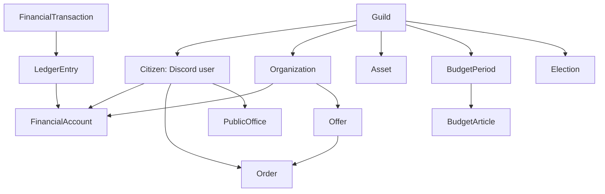

# 05. Модель данных (концептуальная)

База данных — PostgreSQL. Имена ориентировочные. Цель — обеспечить строгие ограничения и простоту расширения без RPG-персонажей.

## 5.1. Основные сущности

| Таблица | Существенные поля | Ограничения |
|---|---|---|
| `guilds` | `id`, `discord_guild_id`, `created_at`, `timezone` | уникальный `discord_guild_id` |
| `citizens` | `id`, `guild_id`, `discord_user_id`, `status`, `joined_at`, `verified_at` | UNIQUE(guild_id, discord_user_id) |
| `organizations` | `id`, `guild_id`, `type`, `name`, `status`, `owner_citizen_id?` | type=`COMPANY`/`STATE`/`NPC`; уникальное активное имя в сервере |
| `financial_accounts` | `id`, `guild_id`, `owner_type`, `owner_id`, `kind`, `status`, `cached_balance` | владелец, категория счёта, CHECK обычный баланс >=0 |
| `financial_transactions` | `id`, `guild_id`, `type`, `status`, `idempotency_key`, `reference_type`, `reference_id`, `created_at` | UNIQUE(guild_id, type, idempotency_key) |
| `ledger_entries` | `id`, `transaction_id`, `account_id`, `delta`, `created_at` | `delta` integer, сумма по транзакции 0 (проверка в сервисе/DB safeguard) |
| `budget_periods` | `id`, `guild_id`, `start_at`, `end_at`, `status`, `total_cap` | UNIQUE(guild_id, start_at) |
| `budget_articles` | `id`, `period_id`, `code`, `limit`, `spent`, `reserved` | UNIQUE(period_id, code), не превышать лимит |
| `work_tasks` | `id`, `guild_id`, `issuer_org_id`, `reward`, `requirements`, `status`, `expires_at` | лимиты и правила задания |
| `work_claims` | `id`, `task_id`, `citizen_id`, `status`, `approved_by`, `payout_tx_id` | защита от повторного выполнения/выплаты |
| `offers` | `id`, `seller_org_id`, `title`, `price`, `status`, `terms` | price >0 |
| `orders` | `id`, `offer_id`, `buyer_account_id`, `escrow_account_id`, `price`, `tax_bp_snapshot`, `status`, `deadline` | валидный автомат статусов |
| `assets` | `id`, `guild_id`, `kind`, `name`, `status`, `price`, `owner_type`, `owner_id`, `metadata` | объект имеет не более одного текущего владельца |
| `asset_transfers` | `id`, `asset_id`, `from_owner`, `to_owner`, `related_tx_id`, `created_at` | история неизменяема |
| `public_offices` | `id`, `guild_id`, `code`, `term_start`, `term_end`, `holder_citizen_id`, `status` | нет конфликтующих активных назначений |
| `elections` | `id`, `guild_id`, `office_code`, `eligible_snapshot`, `external_poll_link`, `status`, `result_payload` | протокол с подтверждением |
| `election_certifications` | `election_id`, `reviewer_citizen_id`, `decision`, `timestamp` | UNIQUE(election_id, reviewer_citizen_id) |
| `bills` | `id`, `guild_id`, `sponsor_id`, `text`, `state`, `votes`, `effective_at` | изменения только из allowlist (NEXT) |
| `audit_events` | `id`, `guild_id`, `actor_id`, `action`, `subject`, `reason`, `timestamp`, `before`, `after` | append-only, скрытые данные редактировать |
| `outbox_messages` | `id`, `event_type`, `payload`, `state`, `attempts`, `created_at` | надёжная доставка уведомлений |
| `job_runs` | `id`, `guild_id`, `kind`, `period_key`, `state` | UNIQUE(guild_id, kind, period_key) |

Отдельные таблицы `contracts`, `employment_contracts`, `property_leases`, `parties`, `laws` добавляются при реализации конкретных NEXT-модулей. Не создавать всё «на всякий случай» в первой миграции.

## 5.2. Отношения

**Важно:** `Citizen` является игровым представлением Discord-аккаунта. Не вводить `PlayerAccount→Character` или таблицу `characters` в R1.

## 5.3. Состояния и переходы

### Гражданин

`PENDING → VERIFIED → SUSPENDED / LEFT`; восстановление при повторном вступлении идёт через отдельную проверку (не новый гражданин/стартовые деньги).

### Компания

`DRAFT → ACTIVE → SUSPENDED → CLOSED`. Закрытие компании с долгами, открытыми заказами и средствами требует регламента; R1 может запретить закрытие, пока обязательства не урегулированы.

### Заказ

`CREATED → FUNDED → IN_PROGRESS → DELIVERED → COMPLETED`  
Альтернативы: `CREATED/FUNDED/IN_PROGRESS/DELIVERED → DISPUTED` или `CANCELLED/REFUNDED` по регламенту.

Только переход `DELIVERED → COMPLETED` делает финальный расчёт; `FUNDED` означает блокировку в эскроу. Повторный вызов не меняет результат.

### NPC-выполнение

`AVAILABLE → CLAIMED → SUBMITTED → APPROVED → PAID`; отказ `REJECTED`, просрочка `EXPIRED`. Возможен автоматический `CLAIMED → APPROVED` для подтверждаемого задания, но выплата всё равно уникальна.

## 5.4. Целостность

- `amount`/`price`/`delta`: BIGINT, целые игровые единицы; границы величины проверять до записи.
- Балансы можно кэшировать, но источником правды является журнал проводок. Расхождение — критический инцидент.
- Не допускать удаления счетов с историей: вместо удаления архивировать.
- Блокировать объект продажи на уровне БД, чтобы его нельзя было продать одновременно двоим.
- Любое изменение прав собственности содержит ссылку на финансовую операцию или админский акт с причиной.
- Для регистраций, выплаты задание/зарплаты и активации выборов создать уникальные ключи идемпотентности.
- Аудит админских корректировок: кто, зачем, какая запись исправлена, документ-основание.

## 5.5. Первая миграция (минимальный набор)

Первый срез гражданства создаёт `guilds`, `citizens`, `audit_events`. Уникальная пара `(guild_id, discord_user_id)` сохраняет одну запись гражданства, а событие создания или восстановления записывается в той же транзакции.

Миграция `0002_ledger` добавляет `financial_accounts`, `financial_transactions` и `ledger_entries`. В первом варианте счетов достаточно личного, казны и эмитента. Составные внешние ключи привязывают счета, проводки и инициатора платежа к одной гильдии. Баланс рассчитывается из журнала.

Миграция `0003_npc_jobs` добавляет `budget_periods`, `budget_articles`, `work_tasks` и `work_claims`. Период идентифицируется сервером и локальной датой понедельника. Одно задание допускает одну заявку. Оплаченная заявка ссылается на бюджетный период и уникальную проводку `NPC_PAYOUT` из казны на личный счёт. Откат миграции после появления выплат потребует сохранения журнала и отдельной процедуры.

Миграция `0004_market` добавляет `organizations`, `offers`, `orders` и привязки финансового счёта к компании или эскроу заказа. Цена, условия, срок и налоговая ставка фиксируются в заказе. Ограничения БД проверяют связь регистрации компании со сбором, заказа с резервом и закрытия с расчётом или возвратом. Уже проведённые платежи сохраняются при обновлении с `0003_npc_jobs`.

Миграция `0005_assets` добавляет уникальные объекты `assets` и историю права `asset_transfers`. Выставленный объект принадлежит государству. Купленный объект ссылается либо на гражданина, либо на компанию той же гильдии. Запись покупки связывает владельца, исходную цену и проводки личного или корпоративного счёта в казну. Проверка PostgreSQL сверяет эти данные при коммите.

Миграция `0006_treasury` добавляет `state_contracts`, `contract_budget_approvals`, `treasury_audit_events` и счётчики резервов к существующему недельному бюджету. Резерв учитывается в статье и общем потолке. Доступные деньги равны остатку счёта казны за вычетом резервов всех недель. Платёж `STATE_CONTRACT_PAYOUT` ссылается на принятый контракт и переводит средства гражданину или его фирме. Отказы по полномочиям фиксируются отдельной записью после отката операции. Откат миграции с историей контрактов, утверждений или отказов запрещён.

Миграция `0007_weekly_reports` добавляет `weekly_report_deliveries`. Запись одновременно отмечает запланированную публикацию недели и хранит агрегированный отчёт для повторной доставки. Ключ по гильдии и дате начала недели уникален. Срок блокировки и токен попытки позволяют другому процессу продолжить отправку после остановки воркера. Отметка доставки сохраняет ID сообщения Discord.

Миграция `0008_private_jobs` добавляет `private_jobs` и отдельную привязку счёта эскроу к заданию. Записи `PRIVATE_JOB_FUND`, `PRIVATE_JOB_PAY` и `PRIVATE_JOB_REFUND` связывают резерв, выплату или возврат с исходным заданием. При коммите PostgreSQL проверяет владельца счёта, сумму и соответствие проводок состоянию задания.

Миграция `0009_government` сохраняет выборы, снимок допуска, список кандидатов, агрегаты внешнего голосования, подтверждение комиссии и сроки должностей. Повтор подтверждения использует прежнее решение. Мандат вступает в силу после завершения предшествующего срока и действует до даты окончания. Сертифицированные протоколы и сроки хранятся в истории.
